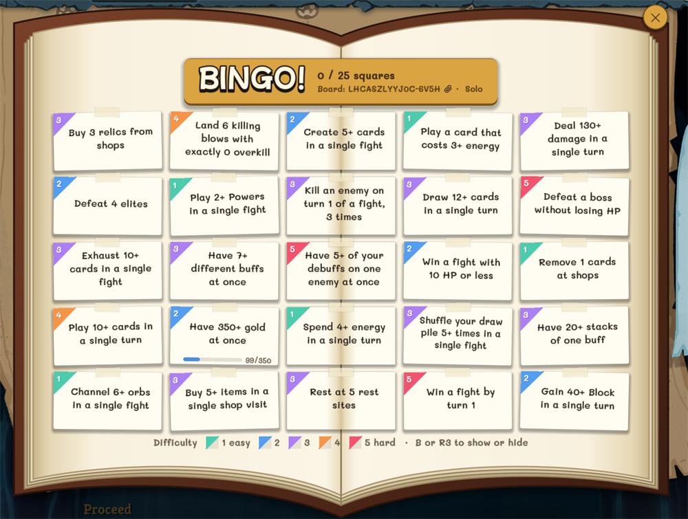
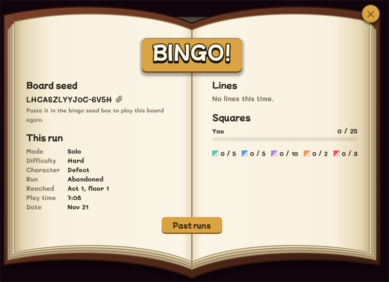
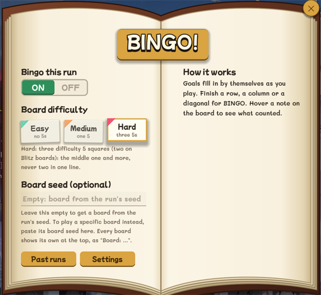
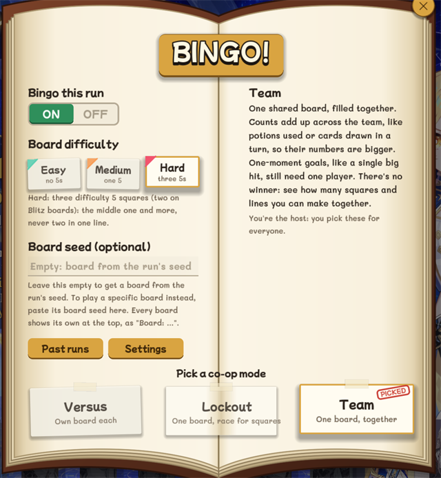

# Bingo the Spire

A **Slay the Spire 2** mod that adds a bingo board to every run. **[Get it on the Steam Workshop](https://steamcommunity.com/sharedfiles/filedetails/?id=3843939707)**

Each square is a goal, like *"Have 40+ Block at once"* or *"Defeat a boss without losing HP"*. You don't mark anything yourself: **squares fill in automatically** when you complete them. Finish a row, a column or a diagonal and you get **BINGO!**

<p align="center">
  
</p>

## How it works

- **Start any run.** The board is ready from the first floor. Open it with the bingo button at the top of the screen, or press **B**.
- **Play as normal.** When you complete a goal, its square fills in and a note pops up.
- **Make a line.** Five in a row, column or diagonal is a BINGO! Keep going for more lines if you like.
- **See how you did.** When the run ends, a results page shows your lines, where you made them and how many squares you filled.

<p align="center">
  
</p>

## Play alone or with friends

**Solo:** you against the board.

**Co-op:** everyone plays the same run together, and the host picks one of three modes:

| Mode | How it works |
|---|---|
| **Versus** | Everyone gets their own copy of the same board. First to make a line wins. |
| **Lockout** | One shared board. Complete a goal first and the square is yours, locked for everyone else. |
| **Team** | One shared board, filled together. Some goals add up everyone's progress, so their numbers are bigger. |

## Before the run

Open the bingo button on the character select screen to set things up.

<p align="center">
  
  &nbsp;
  
</p>

- **Bingo on or off** for the run.
- **Board difficulty:**
  - **Easy:** every goal is difficulty 1 to 4.
  - **Medium:** adds one very hard goal in the middle.
  - **Hard:** three very hard goals.
- **Board seed:** leave it empty for a board based on the run, or paste a board's seed to play that exact board. Every board shows its seed at the top, with a paperclip to copy it, so you can share a board with friends.

## Other things it does

- **44 different goals**, including one for each character.
- **Fair boards:** every line is about as hard as every other.
- **Save and quit is fine:** continuing a run brings your board back, progress and all.
- **Past runs:** your results and personal bests are kept, such as your fastest bingo.
- **Controller support**, the game's own menu sounds, and a **colorblind-safe** color option.
- **Works with other mods**, including modded characters, cards and events.
- **It never changes your run.** The mod only watches what happens; it doesn't change cards, rewards or anything else.

## Installing

1. Subscribe to **[Bingo the Spire](https://steamcommunity.com/sharedfiles/filedetails/?id=3843939707)** on the Steam Workshop.
2. Start the game. Bingo is on by default.

To install it by hand instead, download the zip from the [latest release](../../releases/latest) and put the `BingoTheSpire` folder in the game's `mods` folder.

**In co-op, every player needs the mod, on the same version.**

## Feedback

Found a bug, or a goal that feels too easy or too hard? Please [open an issue](../../issues). Goal balance will keep improving with player feedback.

## For developers

How the mod works is written up in [`docs/design-spec.md`](docs/design-spec.md).

<details>
<summary>Building from source</summary>

Requirements: the .NET SDK (9 or later; the tests run on .NET 10) and Slay the Spire 2.

```sh
dotnet build                          # builds and copies the mod to <game>/mods/BingoTheSpire/
dotnet build -c Release               # the build to share: no developer console commands
dotnet build -p:DeployToGame=false    # builds without touching the game folder
dotnet test                           # runs the unit tests (no game needed)
dotnet run --project tools/BranchCheck   # checks the built mod against each branch's game files in refs/
```

If the game isn't at the default Steam path, create a `local.props` file in the repo root (it's gitignored):

```xml
<Project>
  <PropertyGroup>
    <GameDir>D:\SteamLibrary\steamapps\common\Slay the Spire 2</GameDir>
  </PropertyGroup>
</Project>
```

To compile against a specific branch's game files, put copies of `sts2.dll`, `GodotSharp.dll` and `0Harmony.dll` in `refs/main/` (used automatically when present) or set `Sts2RefDir`. Game files are never committed.

| Path | Contents |
|---|---|
| `src/BingoTheSpire.Core` | Bingo logic with no game dependencies: events, detectors, goals, board builder, rules |
| `src/BingoTheSpire.Mod` | The mod: entry point, game adapter (hooks), network messages, UI, save files |
| `tests/BingoTheSpire.Core.Tests` | Unit, determinism and replay tests |
| `tools/BranchCheck` | Checks the built mod against the main and beta game files |
| `docs/` | Design spec and screenshots |

</details>

## License

All rights reserved. The source is public to read, but it isn't open source. See [`LICENSE`](LICENSE).

Not affiliated with Mega Crit.
